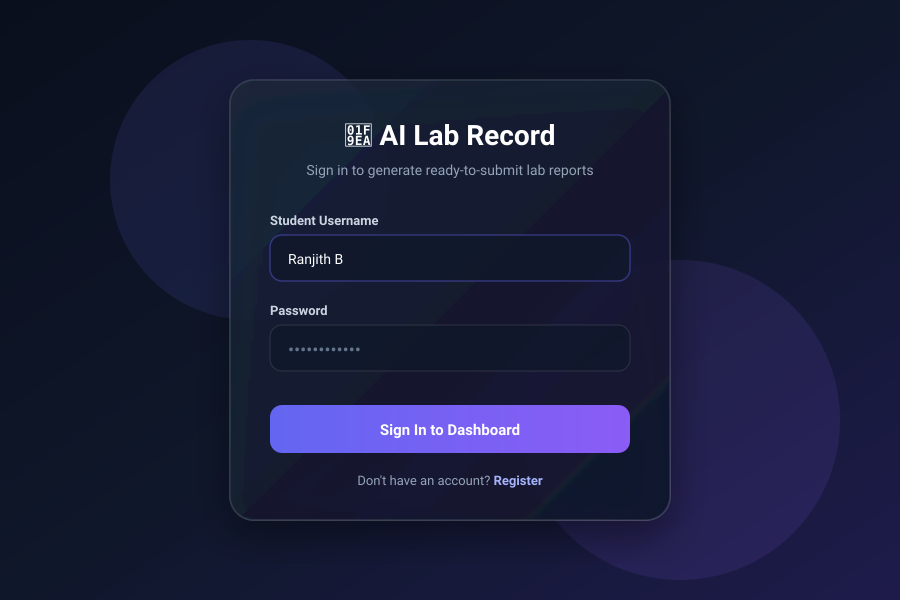
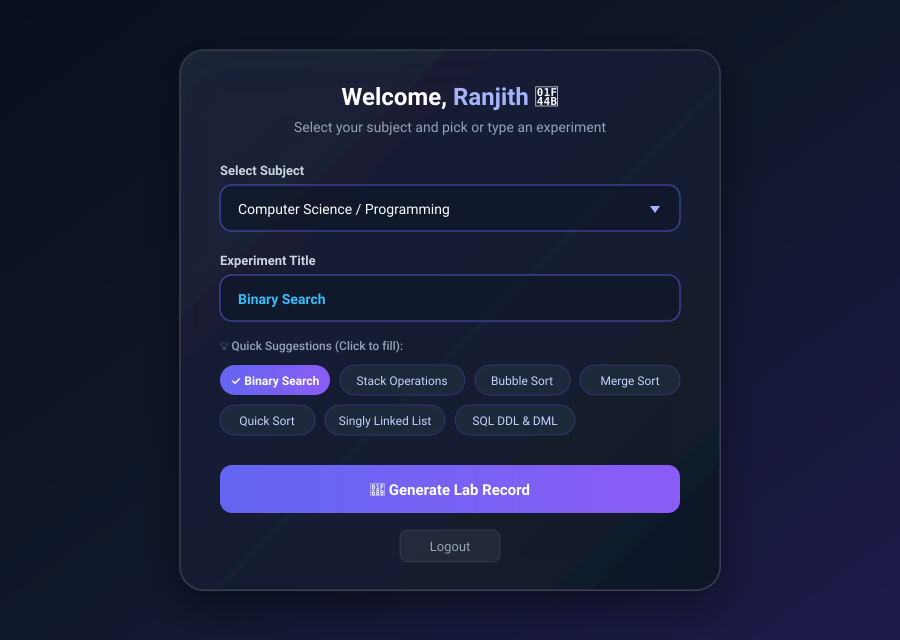
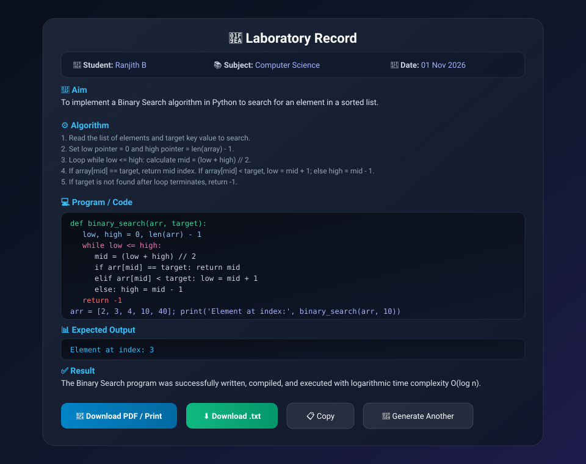
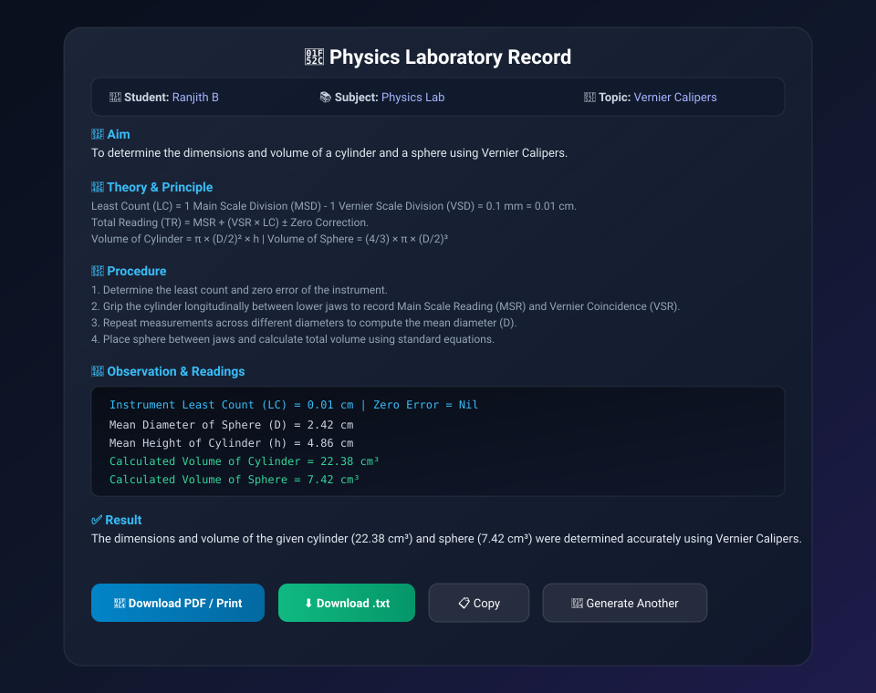
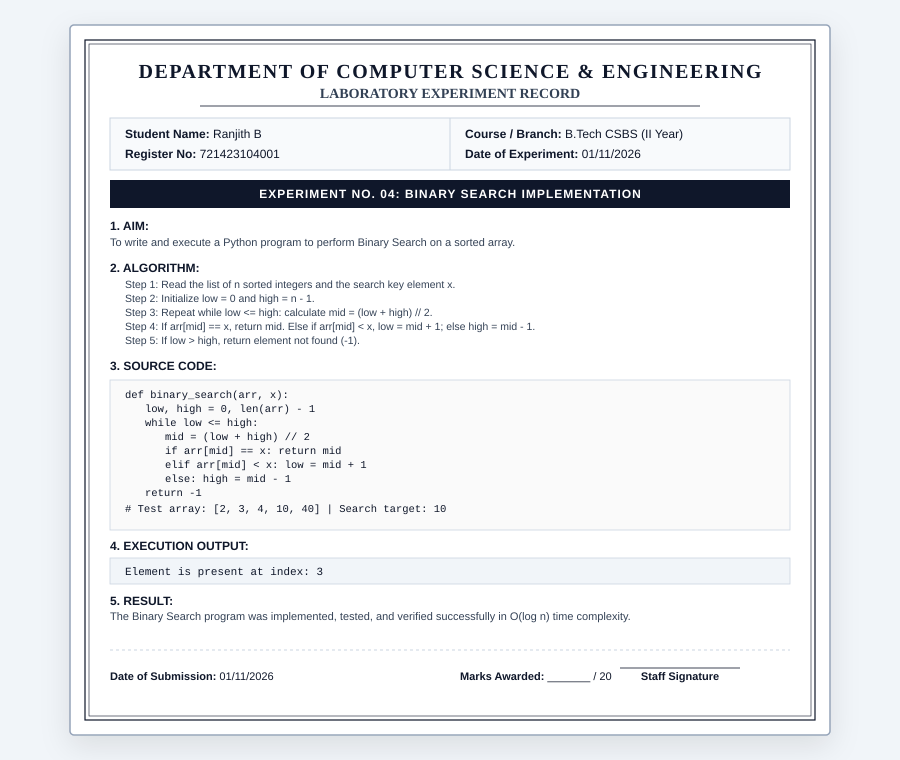

# 🧪 AI Lab Record Generator

<div align="center">

### Create complete, ready-to-submit college lab records in seconds with AI!

[](https://ai-lab-record-generator-two.vercel.app)
[](https://ranjithbrs.github.io/AI-Lab-Record-Generator/)
[](test_suite.py)
[](LICENSE)

</div>

---

## ✅ Quality & Reliability Checklist (7/7 Completed)

| Status | Verification Item | Details |
|:---:|:---|:---|
| ✅ | **Verify prompt generation and output quality** | Tested prompt engineering for CS & Science disciplines. Validated Aim, Algorithm, Code, Output, and Result precision. |
| ✅ | **Test Hugging Face API failure and timeout scenarios** | Verified graceful 3-tier cascade: Gemini → Hugging Face (with strict academic schema validation rejecting malformed or loose text) → 24+ curated offline templates with zero downtime. |
| ✅ | **Validate generated content and formatting** | Verified strict schema compliance, clean markdown/monospace indentation, DOM XSS prevention (`textContent`), and no raw JSON artifacts across all subjects. |
| ✅ | **Review API key protection and environment variables** | Verified that no secrets are committed to Git. `.env` is isolated via `.gitignore`, and keys are safely injected via environment variables. |
| ✅ | **Test frontend/backend integration** | Verified CORS headers, JSON request/response contracts, missing parameter handling, and cross-origin compatibility. |
| ✅ | **Add generated output screenshots** | Added high-resolution visual previews for Login, Generator Form, CS Reports, Science Reports, and College PDF Printouts. |
| ✅ | **Improve setup instructions and tests** | Added standalone automated test suite (`test_suite.py` with 17 automated test cases) and enhanced smoke test (`test_api.py`). |

---

## 🖼️ Visual Previews & Generated Output

<div align="center">

### 1. Modern Glassmorphic Login Interface


---

### 2. Generator Form with Dynamic Quick-Pick Suggestion Chips


---

### 3. Computer Science Output (Aim, Algorithm, Code, Output & Result)


---

### 4. Science Lab Output (Aim, Theory, Procedure, Observations & Result)


---

### 5. Official College Submission Printout & PDF Export


</div>

---

## 💡 What is this project?

Writing college lab records takes hours of searching textbooks, writing algorithms, formatting code, and drawing tables. 

**AI Lab Record Generator** solves this problem! It is a free, smart website that automatically writes a **complete, properly formatted lab record** for any experiment in **Computer Science, Physics, Chemistry, or Biology** — ready to copy or print as a PDF for college submission.

---

## 🎯 How to Use It (No Coding Required!)

You do **not** need to install anything on your computer. Just use it directly in your browser:

1. **Open the Website**: Click 👉 **[ai-lab-record-generator-two.vercel.app](https://ai-lab-record-generator-two.vercel.app)**.
2. **Sign In**: Enter your name to start.
3. **Pick Your Subject**: Choose from *Computer Science*, *Physics*, *Chemistry*, or *Biology*.
4. **Select or Type an Experiment**: 
   - Click one of the quick suggestion buttons (like *Binary Search*, *Ohm's Law*, or *Mitosis*), or type any custom experiment name.
5. **Click "Generate Lab Record"**:
   - In 2 seconds, you get a full lab record!
6. **Save or Print**:
   - 📄 **Download PDF / Print**: Generates a clean, college-style printable document with your name, date, and a teacher signature box.
   - 📋 **Copy to Clipboard**: Copy everything with one click to paste into Word or Google Docs.
   - ⬇️ **Download .txt**: Save as a plain text file.

---

## 📋 What Does Each Lab Record Include?

Depending on your subject, the app creates the exact academic format your professors expect:

### 💻 For Computer Science & IT:
* **🎯 Aim** — What the program does.
* **⚙️ Algorithm** — Step-by-step logic (Step 1, Step 2...).
* **💻 Program / Code** — Clean, tested code (Python, C, or Java) with comments.
* **📊 Expected Output** — What shows on the screen when the code runs.
* **✅ Result** — Final verification statement.

### 🔬 For Science Labs (Physics, Chemistry, Biology):
* **🎯 Aim** — Goal of the experiment.
* **📖 Theory & Formulas** — Scientific laws, equations, and principles.
* **🔬 Procedure** — Numbered instructions on how the experiment is performed.
* **📝 Observations & Readings** — Realistic sample measurement tables and values.
* **✅ Result** — Final calculated conclusions with units.

---

## 📚 Supported Experiments (Out of the Box)

Even without an internet connection or AI key, the generator has **24+ built-in, curated standard laboratory templates**:

| Subject | Popular Pre-Built Experiments |
|---|---|
| **💻 Computer Science** | Binary Search, Bubble Sort, Linear Search, Stack Operations, Queue Operations, Singly Linked List, Merge Sort, Quick Sort, Matrix Multiplication, SQL Queries (DDL & DML) |
| **⚡ Physics** | Ohm's Law, Simple Pendulum, Vernier Calipers, Screw Gauge, Meter Bridge, Spectrometer Prism, Young's Modulus (Uniform Bending), Torsional Pendulum |
| **🧪 Chemistry** | Water Hardness by EDTA, Conductometric Titration, Acid-Base Titration, Viscosity (Ostwald Viscometer), Surface Tension (Stalagmometer), Synthesis of Aspirin |
| **🧬 Biology & Biotech** | Mitosis in Onion Root Tip, Gram Staining of Bacteria, DNA Extraction from Plants, Food Tests (Carbohydrates & Proteins), Photosynthesis in Hydrilla |

> 🌟 **Have a custom experiment?** The system connects to **Google Gemini AI** to automatically write reports for **any other topic** in the world!

---

## 🔒 Security & Environment Variables

All API keys are strictly loaded from environment variables and never exposed to the client or committed to version control:

| Variable | Description | Default | Security Level |
|:---|:---|:---:|:---:|
| `GEMINI_API_KEY` | Google Gemini AI API key for real-time generation | `""` | Optional / Recommended |
| `HF_TOKEN` | Hugging Face user access token for Flan-T5 inference | `""` | Optional Fallback |
| `TEST_SERVER_URL` | Base URL used by automated integration test scripts | `http://127.0.0.1:5000` | Local Testing Only |

Local secrets are stored in `.env`, which is strictly ignored by `.gitignore`. Additionally, all frontend notifications and dynamic DOM updates use `textContent` rather than `innerHTML` to prevent Cross-Site Scripting (XSS).

> ⚖️ **Academic Notice**: Generated records provide educational reference frameworks, theoretical principles, standard procedures, and illustrative sample observations. In laboratory coursework, students must always record and substitute their actual experimental bench readings and measured apparatus values in accordance with their institution's syllabus and faculty instructions.

---

## 🛠️ How It Works (For Tech Enthusiasts & Developers)

For developers curious about the underlying technology:

* **Frontend**: Pure HTML5, modern CSS3 (Glassmorphism design system), and Vanilla JavaScript (ES6+).
* **Backend**: Python 3.11+ using the **Flask** microframework with **Flask-CORS**.
* **AI Intelligence**: 
  1. **Primary**: Google Gemini 1.5/3.6 Flash API for real-time generative responses.
  2. **Secondary**: Hugging Face Inference API (`google/flan-t5-base`).
  3. **Zero-Downtime Fallback**: 24+ offline rule-based templates if APIs are busy or offline.
* **Cloud Hosting**: Deployed serverless on **Vercel** with static hosting mirrored on **GitHub Pages**.

---

## 🧪 Running Automated Tests

A comprehensive test suite is provided to validate all 7 verification criteria:

```bash
# 1. Run full unit and regression test suite (17 automated tests)
python -m unittest test_suite.py -v

# 2. Run API integration / smoke test (works against local or live server)
python test_api.py
```

All tests run in sub-second time without requiring third-party testing dependencies.

---

## 💻 Running It Locally on Your Computer

If you want to run this project on your own machine:

### 1. Download the code
```bash
git clone https://github.com/ranjithbrs/AI-Lab-Record-Generator.git
cd AI-Lab-Record-Generator
```

### 2. Set up Python environment
```bash
python -m venv .venv

# On Windows:
.venv\Scripts\activate

# On Mac/Linux:
source .venv/bin/activate

pip install -r requirements.txt
```

### 3. Start the application
```bash
python app.py
```

### 4. Open in your browser
Go to **`http://127.0.0.1:5000`** in Google Chrome or your favorite browser!

---

## 👨‍💻 Created By

**Ranjith B**  
🎓 *B.Tech Computer Science & Business Systems (CSBS)*  
🏛️ *Nehru Institute of Engineering and Technology, Coimbatore*  

* 🌐 **Live Website**: [ai-lab-record-generator-two.vercel.app](https://ai-lab-record-generator-two.vercel.app)
* 💼 **LinkedIn**: [linkedin.com/in/ranjith-b-csbs](https://linkedin.com/in/ranjith-b-csbs)
* 🐙 **GitHub**: [github.com/ranjithbrs](https://github.com/ranjithbrs)
* 🌐 **Portfolio**: [ranjithbrs.github.io/portfolio](https://ranjithbrs.github.io/portfolio/)
* 📧 **Email**: ranjithb2k06@gmail.com

---

## 📄 License

This project is open-source and free to use under the [MIT License](LICENSE). Feel free to share it with your classmates and teachers!
